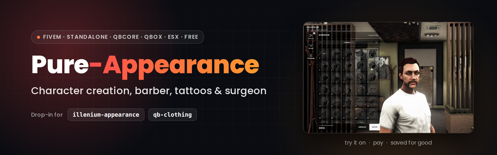

<details name="langue">
<summary><picture></picture></summary>

<div align="center">

<sub>🧩 <b>Suite Pure</b> &nbsp;·&nbsp; <a href="https://github.com/ma3iich/pure-target">Pure-Target</a> (menu clic droit) &nbsp;·&nbsp; <a href="https://github.com/ma3iich/pure_inventory">Pure Inventory</a> (inventaire) &nbsp;·&nbsp; <a href="https://github.com/ma3iich/pure_clothing">Pure Clothing</a> (vêtements) &nbsp;·&nbsp; <b>Pure Appearance</b> (apparence)</sub>


<br>

# Pure Appearance

**La création de personnage, le coiffeur, le tatoueur et le chirurgien, dans un menu sobre et léger.**<br>
Remplace illenium-appearance et qb-clothing sans rien casser. Standalone, QBCore, Qbox ou ESX.

[](https://fivem.net)
[](https://www.lua.org)
[](#-installation)
[](#-langues)
[](LICENSE)
[](https://github.com/ma3iich/pure_appearance/releases)
[](https://www.youtube.com/watch?v=iadg709uEHc)
[](https://discord.gg/4d5cxh2GHs)

**[⬇️ Télécharger](https://github.com/ma3iich/pure_appearance/releases/latest)** &nbsp;·&nbsp;
**[🎬 Vidéo](https://www.youtube.com/watch?v=iadg709uEHc)** &nbsp;·&nbsp;
**[📦 Installation](#-installation)** &nbsp;·&nbsp;
**[⚙️ Configuration](#%EF%B8%8F-configuration)** &nbsp;·&nbsp;
**[🧵 Packs et images](#-packs-ajoutés-et-images)** &nbsp;·&nbsp;
**[🔌 Compatibilité](#-compatibilité-et-exports)** &nbsp;·&nbsp;
**[❓ FAQ](#-faq)**

<sub>Fait par <a href="https://github.com/ma3iich">ma3iich</a></sub>

</div>

---

## 🎬 Aperçus

<table>
  <tr>
    <th width="50%">🧬 Hérédité</th>
    <th width="50%">🙂 Visage</th>
  </tr>
  <tr>
    <td><video src="https://github.com/user-attachments/assets/afab0834-fe4e-4af8-9465-d42eb1f8ddb3" width="100%" controls muted></video></td>
    <td><video src="https://github.com/user-attachments/assets/16ab729e-1f56-43fb-949b-78a8b36754ce" width="100%" controls muted></video></td>
  </tr>
  <tr>
    <th width="50%">💇 Cheveux</th>
    <th width="50%">🧔 Pilosité</th>
  </tr>
  <tr>
    <td><video src="https://github.com/user-attachments/assets/d2c0c24d-a508-40be-87ad-e9c0b8af8315" width="100%" controls muted></video></td>
    <td><video src="https://github.com/user-attachments/assets/b2180d68-efbe-453f-984d-2faa17d255e6" width="100%" controls muted></video></td>
  </tr>
  <tr>
    <th width="50%">👕 Tenue de départ</th>
    <th width="50%">🖋️ Tatouages</th>
  </tr>
  <tr>
    <td><video src="https://github.com/user-attachments/assets/a93e304c-88c0-4173-9329-8aa15689c71f" width="100%" controls muted></video></td>
    <td><video src="https://github.com/user-attachments/assets/c7ee991b-dc7e-4630-a632-a396eb14c79c" width="100%" controls muted></video></td>
  </tr>
  <tr>
    <th width="50%">💈 Coiffeur</th>
    <th width="50%">🖋️ Tatoueur</th>
  </tr>
  <tr>
    <td><video src="https://github.com/user-attachments/assets/f3e2bcf1-b323-4be5-98e0-1d647f46d470" width="100%" controls muted></video></td>
    <td><video src="https://github.com/user-attachments/assets/80c60f5d-cc1a-43db-868f-334b9311d823" width="100%" controls muted></video></td>
  </tr>
  <tr>
    <th width="50%">🩺 Chirurgien</th>
    <th width="50%">🎥 Caméra et touches</th>
  </tr>
  <tr>
    <td><video src="https://github.com/user-attachments/assets/73ed7120-d1a7-4323-91df-2da727c0e7d6" width="100%" controls muted></video></td>
    <td><video src="https://github.com/user-attachments/assets/66ffa5cc-cbce-4283-8ccf-f26488b70e71" width="100%" controls muted></video></td>
  </tr>
</table>

---

## ✨ Fonctionnalités

<table>
  <tr>
    <td width="50%">🧬 <b>Création complète</b><br><sub>Hérédité avec les portraits des parents, 20 traits du visage, peau, yeux, cheveux et reflets, pilosité, maquillage, tenue de départ et tatouages. Gratuite, une seule fois.</sub></td>
    <td width="50%">💈 <b>Coiffeur, tatoueur, chirurgien</b><br><sub>Tout s'essaie sur le perso avant de payer. Prix par catégorie chez le coiffeur, panier de tatouages (on en ajoute, on en retire), forfait chez le chirurgien.</sub></td>
  </tr>
  <tr>
    <td>🧵 <b>Natif / Nouveautés</b><br><sub>Les visages, portraits, coupes et tatouages ajoutés par des packs arrivent tout seuls dans l'onglet « Nouveautés ». Les coupes, barbes, sourcils, poils du torse, maquillages et les 743 tatouages du jeu sont livrés avec leur image.</sub></td>
    <td>🔁 <b>Remplacement direct</b><br><sub>Mêmes exports et événements qu'illenium-appearance et qb-clothing, mêmes tables : les autres scripts marchent sans rien changer, les joueurs gardent leur perso. Les anciens persos qb-clothing sont convertis tout seuls.</sub></td>
  </tr>
  <tr>
    <td>🎨 <b>Entièrement réglable</b><br><sub>Taille du menu, côté de l'écran, logo, police, couleurs, touches, prix, boutiques, cartes. 9 langues.</sub></td>
    <td>🛡️ <b>Le serveur ne fait pas confiance</b><br><sub>Prix recalculés par le serveur, seule la partie vendue est gardée (un coiffeur ne change pas le visage), distance vérifiée, valeurs bornées, création gratuite une seule fois.</sub></td>
  </tr>
  <tr>
    <td>⚡ <b>Léger</b><br><sub>Aucune boucle loin des boutiques, rien qui tourne quand le menu est fermé.</sub></td>
    <td>🧩 <b>Suite Pure</b><br><sub>Clic droit avec pure-target, photos de la tenue de départ avec pure_clothing, argent de l'inventaire avec pure_inventory en standalone.</sub></td>
  </tr>
</table>

---

## 📋 Dépendances

| Ressource | Obligatoire | Remarques |
| --- | --- | --- |
| [oxmysql](https://github.com/overextended/oxmysql) | ✅ | enregistre l'apparence |
| [ox_lib](https://github.com/overextended/ox_lib) | ✅ | |
| qb-core / qbx_core / es_extended | facultatif | sans framework : mode standalone |
| [pure-target](https://github.com/ma3iich/pure-target), ox_target ou qb-target | facultatif | sinon : touche E devant la boutique |
| [pure_clothing](https://github.com/ma3iich/pure_clothing) | facultatif | photos des vêtements de la tenue de départ |
| [pure_inventory](https://github.com/ma3iich/pure_inventory) ou ox_inventory | facultatif | en standalone : on paye avec l'objet `money` |

---

## 📦 Installation

1. Télécharge la [dernière version](https://github.com/ma3iich/pure_appearance/releases/latest) et mets le dossier `pure_appearance` dans tes `resources`.
2. **Retire illenium-appearance ou qb-clothing** (supprime le dossier ou son `ensure`). Pure Appearance prend leur place : les scripts qui les appellent continuent de marcher. **ESX :** retire aussi `esx_skin` et `skinchanger`, Pure Appearance les remplace (esx_multicharacter démarre sans eux).
3. Dans `server.cfg` :
   ```cfg
   ensure oxmysql
   ensure ox_lib
   ensure qb-core          # ou qbx_core / es_extended, rien en standalone
   ensure pure-target      # facultatif
   ensure pure_appearance
   ```
4. Démarre le serveur. Pure Appearance utilise les mêmes tables qu'illenium-appearance (`playerskins` pour QBCore / Qbox, `users.skin` pour ESX). En standalone, la table `pure_appearance` se crée toute seule.
5. Ouvre `config.lua` pour la langue, le look du menu, les prix et les boutiques.

**Nouveau personnage :** la création s'ouvre toute seule après le formulaire de qb-multicharacter, esx_multicharacter ou esx_identity (ESX sans multicharacter).

---

## ⚙️ Configuration

Tout est dans `config.lua`, avec une explication à côté de chaque réglage.

| Réglage | Rôle |
| --- | --- |
| `Config.Locale` | langue : `en`, `fr`, `es`, `de`, `it`, `pt`, `nl`, `pl`, `tr` |
| `Config.Framework` | `auto`, ou `qbx`, `qb`, `esx`, `standalone` |
| `Config.Ui` | taille du menu (`scale`), côté (`side`), `logo`, police (`font`), couleurs (`colors`) |
| `Config.Keys` | touches : cacher le menu, caméra visage / buste / corps |
| `Config.PayWith` | compte payé en premier : `cash` ou `bank` |
| `Config.StandaloneMoneyItem` | objet d'argent en standalone (`money`) |
| `Config.Prices` | prix du coiffeur (par catégorie), du chirurgien, des tatouages, du retrait |
| `Config.CreationClothes` | rayons de la tenue de départ |
| `Config.AddonFaces` / `Config.AddonTattoos` | visages et tatouages ajoutés par des packs |
| `Config.Shops` / `Config.Blips` | boutiques (coiffeur, tatoueur, chirurgien), PNJ, icônes de la carte |
| `Config.Surgeon` | `false` = pas de chirurgien du tout (ni PNJ, ni icône, ni menu) |
| `Config.AdminCommand` / `Config.ReloadCommand` | `/appearance [id]` (admins, gratuit) et `/reloadskin` |
| `Config.CheckUpdates` | contrôle des mises à jour (une ligne dans la console) |

---

## 🌍 Langues

Anglais, français, espagnol, allemand, italien, portugais, néerlandais, polonais et turc, dans `locales/`.
Pour ajouter la tienne : copie `locales/en.json` en `locales/xx.json`, traduis, puis `Config.Locale = 'xx'`. Un texte manquant s'affiche en anglais.

---

## 🧵 Packs ajoutés et images

- **Visages :** les visages au-delà des 46 du jeu sont trouvés tout seuls (`Config.AddonFaces = 'auto'`).
- **Coupes :** une coupe d'une collection qui n'est pas du jeu va dans « Nouveautés ».
- **Tatouages :** ajoute-les dans `Config.AddonTattoos` (mêmes champs que `shared/tattoos.lua`, avec un `price` si tu veux).

**Tes propres images.** Les éléments du jeu sont livrés avec leur image. Une case sans image montre son numéro (une icône pour un tatouage). Pour donner une image à un élément ajouté, ou changer celle d'un élément que ton pack remplace, dépose un fichier **WebP carré** (160 × 160 conseillé) au bon endroit (`m` = homme, `f` = femme), puis tape `refresh` et `restart pure_appearance` dans la console du serveur :

| Élément | Où mettre l'image |
| --- | --- |
| Visage ajouté | `web/portraits/<m\|f>/<numéro>.webp` |
| Coupe | `web/miniatures/<m\|f>/c2/<collection>/<numéro>.webp` (`_base` = coupes du jeu) |
| Barbe, sourcils, poils du torse | `web/images/<m\|f>/<beard\|eyebrows\|chestHair>/<numéro affiché>.webp` |
| Maquillage, blush, rouge à lèvres | `web/images/<m\|f>/<makeUp\|blush\|lipstick>/<numéro affiché>.webp` |
| Tatouage (du jeu ou ajouté) | `web/images/tattoos/<name>.webp` (le `name` du tatouage, ex. `TAT_AR_000.webp`) |
| Vêtement de la tenue de départ | dans [Pure Clothing](https://github.com/ma3iich/pure_clothing) (ses photos servent aussi ici) |

Exemple : la barbe n° 12 des hommes → `web/images/m/beard/12.webp`.
---

## 🔌 Compatibilité et exports

**Exports d'illenium-appearance** (client) : `getPedAppearance`, `setPlayerAppearance`, `setPedAppearance`, `getPedModel`, `getPedComponents`, `getPedProps`, `getPedHeadBlend`, `getPedFaceFeatures`, `getPedHeadOverlays`, `getPedHair`, `setPlayerModel`, `setPedHeadBlend`, `setPedFaceFeatures`, `setPedHeadOverlays`, `setPedHair`, `setPedEyeColor`, `setPedComponent(s)`, `setPedProp(s)`, `setPedTattoos`.

**Événements repris :** `qb-clothes:client:CreateFirstCharacter`, `qb-clothing:client:loadPlayerClothing`, `qb-clothes:loadSkin`, `qb-clothing:client:openMenu`, `qb-clothing:client:loadOutfit`, `qb-clothes:loadPlayerSkin`, `esx_skin:openSaveableMenu`, `esx_skin:playerRegistered`, `skinchanger:loadSkin`, `skinchanger:getSkin`, `illenium-appearance:client:reloadSkin`, `illenium-appearance:server:saveAppearance` (vêtements seulement).

| Côté | Export / événement | Rôle |
| --- | --- | --- |
| client | `exports.pure_appearance:openMenu(mode)` | ouvre `creation`, `barber`, `tattoo` ou `surgeon` (le serveur vérifie le droit et le prix) |
| client | `exports.pure_appearance:reloadSkin()` | remet l'apparence enregistrée |
| client | `exports.pure_appearance:isMenuOpen()` | le menu est-il ouvert ? |
| client | événement `pure_appearance:client:saved` (mode, apparence) | envoyé après chaque enregistrement |

---

## ❓ FAQ

<details><summary><b>Une case montre un numéro au lieu d'une image</b></summary>
Elle n'a pas encore d'image : tu peux lui en donner une, voir <a href="#-packs-ajoutés-et-images">packs et images</a>.
</details>

<details><summary><b>Où sont les magasins de vêtements et les tenues ?</b></summary>
Pure Appearance s'occupe du corps et du visage. Les vêtements, c'est <a href="https://github.com/ma3iich/pure_clothing">Pure Clothing</a> (un vêtement = un objet) ou ton propre script.
</details>

<details><summary><b>La barbe, les sourcils ou le maquillage n'ont pas d'onglet « Nouveautés »</b></summary>
Le jeu a une liste fixe pour ces éléments : un pack peut seulement remplacer les dessins existants, jamais en ajouter. Si ton pack en remplace un, donne-lui sa nouvelle image : voir <a href="#-packs-ajoutés-et-images">packs et images</a>.
</details>

<details><summary><b>Un joueur veut refaire son perso gratuitement</b></summary>
Un admin tape <code>/appearance [id]</code> : le menu complet s'ouvre, gratuit, pour ce joueur.
</details>

<details><summary><b>Où signaler un bug ?</b></summary>
Viens sur le <a href="https://discord.gg/4d5cxh2GHs">Discord</a> et ouvre un ticket, avec la console du serveur et la console F8.
</details>

---

## 📜 Licence

Pure Appearance est publié sous **licence MIT** ([LICENSE](LICENSE)). Copyright © 2026 ma3iich.
La liste des tatouages et le format de l'apparence viennent d'[illenium-appearance](https://github.com/iLLeniumStudios/illenium-appearance) (MIT, © 2021 snakewiz).
Les images des coupes, barbes, maquillages et tatouages sont faites à partir des modèles et des textures de Grand Theft Auto V (© Rockstar Games), fournies pour les serveurs FiveM.

</details>

<details name="langue" open>
<summary><picture></picture></summary>

<div align="center">

<sub>🧩 <b>Pure suite</b> &nbsp;·&nbsp; <a href="https://github.com/ma3iich/pure-target">Pure-Target</a> (right-click menu) &nbsp;·&nbsp; <a href="https://github.com/ma3iich/pure_inventory">Pure Inventory</a> (inventory) &nbsp;·&nbsp; <a href="https://github.com/ma3iich/pure_clothing">Pure Clothing</a> (clothing) &nbsp;·&nbsp; <b>Pure Appearance</b> (appearance)</sub>


<br>

# Pure Appearance

**Character creation, barber, tattoo parlor and plastic surgeon, in a clean and light menu.**<br>
Replaces illenium-appearance and qb-clothing without breaking anything. Standalone, QBCore, Qbox or ESX.

[](https://fivem.net)
[](https://www.lua.org)
[](#-installation-1)
[](#-languages)
[](LICENSE)
[](https://github.com/ma3iich/pure_appearance/releases)
[](https://www.youtube.com/watch?v=iadg709uEHc)
[](https://discord.gg/4d5cxh2GHs)

**[⬇️ Download](https://github.com/ma3iich/pure_appearance/releases/latest)** &nbsp;·&nbsp;
**[🎬 Video](https://www.youtube.com/watch?v=iadg709uEHc)** &nbsp;·&nbsp;
**[📦 Installation](#-installation-1)** &nbsp;·&nbsp;
**[⚙️ Configuration](#%EF%B8%8F-configuration-1)** &nbsp;·&nbsp;
**[🧵 Packs and pictures](#-add-on-packs-and-pictures)** &nbsp;·&nbsp;
**[🔌 Compatibility](#-compatibility-and-exports)** &nbsp;·&nbsp;
**[❓ FAQ](#-faq-1)**

<sub>Made by <a href="https://github.com/ma3iich">ma3iich</a></sub>

</div>

---

## 🎬 Preview

<table>
  <tr>
    <th width="50%">🧬 Heritage</th>
    <th width="50%">🙂 Face</th>
  </tr>
  <tr>
    <td><video src="https://github.com/user-attachments/assets/afab0834-fe4e-4af8-9465-d42eb1f8ddb3" width="100%" controls muted></video></td>
    <td><video src="https://github.com/user-attachments/assets/16ab729e-1f56-43fb-949b-78a8b36754ce" width="100%" controls muted></video></td>
  </tr>
  <tr>
    <th width="50%">💇 Hair</th>
    <th width="50%">🧔 Facial hair</th>
  </tr>
  <tr>
    <td><video src="https://github.com/user-attachments/assets/d2c0c24d-a508-40be-87ad-e9c0b8af8315" width="100%" controls muted></video></td>
    <td><video src="https://github.com/user-attachments/assets/b2180d68-efbe-453f-984d-2faa17d255e6" width="100%" controls muted></video></td>
  </tr>
  <tr>
    <th width="50%">👕 Starting outfit</th>
    <th width="50%">🖋️ Tattoos</th>
  </tr>
  <tr>
    <td><video src="https://github.com/user-attachments/assets/a93e304c-88c0-4173-9329-8aa15689c71f" width="100%" controls muted></video></td>
    <td><video src="https://github.com/user-attachments/assets/c7ee991b-dc7e-4630-a632-a396eb14c79c" width="100%" controls muted></video></td>
  </tr>
  <tr>
    <th width="50%">💈 Barber</th>
    <th width="50%">🖋️ Tattoo parlor</th>
  </tr>
  <tr>
    <td><video src="https://github.com/user-attachments/assets/f3e2bcf1-b323-4be5-98e0-1d647f46d470" width="100%" controls muted></video></td>
    <td><video src="https://github.com/user-attachments/assets/80c60f5d-cc1a-43db-868f-334b9311d823" width="100%" controls muted></video></td>
  </tr>
  <tr>
    <th width="50%">🩺 Plastic surgeon</th>
    <th width="50%">🎥 Camera and keys</th>
  </tr>
  <tr>
    <td><video src="https://github.com/user-attachments/assets/73ed7120-d1a7-4323-91df-2da727c0e7d6" width="100%" controls muted></video></td>
    <td><video src="https://github.com/user-attachments/assets/66ffa5cc-cbce-4283-8ccf-f26488b70e71" width="100%" controls muted></video></td>
  </tr>
</table>

---

## ✨ Features

<table>
  <tr>
    <td width="50%">🧬 <b>Full creation</b><br><sub>Heritage with the parents' portraits, 20 face features, skin, eyes, hair and highlights, facial hair, makeup, starting outfit and tattoos. Free, one time only.</sub></td>
    <td width="50%">💈 <b>Barber, tattoo parlor, surgeon</b><br><sub>Everything is tried on the character before paying. Price per category at the barber, tattoo cart (add some, remove some), flat fee at the surgeon.</sub></td>
  </tr>
  <tr>
    <td>🧵 <b>Base game / New</b><br><sub>Faces, portraits, hairstyles and tattoos added by packs go to the "New" tab by themselves. The game's hairstyles, beards, eyebrows, chest hair, makeup and its 743 tattoos come with their picture.</sub></td>
    <td>🔁 <b>Drop-in replacement</b><br><sub>Same exports and events as illenium-appearance and qb-clothing, same tables: your other scripts keep working, players keep their character. Old qb-clothing characters are converted by themselves.</sub></td>
  </tr>
  <tr>
    <td>🎨 <b>Fully configurable</b><br><sub>Menu size, screen side, logo, font, colors, keys, prices, shops, map icons. 9 languages.</sub></td>
    <td>🛡️ <b>The server trusts nothing</b><br><sub>Prices computed again by the server, only the part a shop sells is kept (a barber can't change the face), distance checked, values clamped, free creation only once.</sub></td>
  </tr>
  <tr>
    <td>⚡ <b>Light</b><br><sub>No loop far from the shops, nothing runs while the menu is closed.</sub></td>
    <td>🧩 <b>Pure suite</b><br><sub>Right-click with pure-target, pictures of the starting outfit with pure_clothing, money from the inventory with pure_inventory in standalone.</sub></td>
  </tr>
</table>

---

## 📋 Dependencies

| Resource | Required | Notes |
| --- | --- | --- |
| [oxmysql](https://github.com/overextended/oxmysql) | ✅ | saves the appearance |
| [ox_lib](https://github.com/overextended/ox_lib) | ✅ | |
| qb-core / qbx_core / es_extended | optional | no framework: standalone mode |
| [pure-target](https://github.com/ma3iich/pure-target), ox_target or qb-target | optional | otherwise: E key in front of the shop |
| [pure_clothing](https://github.com/ma3iich/pure_clothing) | optional | pictures of the starting outfit |
| [pure_inventory](https://github.com/ma3iich/pure_inventory) or ox_inventory | optional | standalone: pay with the `money` item |

---

## 📦 Installation

1. Download the [latest release](https://github.com/ma3iich/pure_appearance/releases/latest) and put the `pure_appearance` folder in your `resources`.
2. **Remove illenium-appearance or qb-clothing** (delete the folder or its `ensure`). Pure Appearance takes their place: the scripts that call them keep working. **ESX:** also remove `esx_skin` and `skinchanger`, Pure Appearance replaces them (esx_multicharacter starts without them).
3. In `server.cfg`:
   ```cfg
   ensure oxmysql
   ensure ox_lib
   ensure qb-core          # or qbx_core / es_extended, nothing in standalone
   ensure pure-target      # optional
   ensure pure_appearance
   ```
4. Start the server. Pure Appearance uses the same tables as illenium-appearance (`playerskins` for QBCore / Qbox, `users.skin` for ESX). In standalone, the `pure_appearance` table is created by itself.
5. Open `config.lua` for the language, the look of the menu, the prices and the shops.

**New character:** the creation opens by itself after the form of qb-multicharacter, esx_multicharacter or esx_identity (ESX without multicharacter).

---

## ⚙️ Configuration

Everything is in `config.lua`, with an explanation next to each setting.

| Setting | What it does |
| --- | --- |
| `Config.Locale` | language: `en`, `fr`, `es`, `de`, `it`, `pt`, `nl`, `pl`, `tr` |
| `Config.Framework` | `auto`, or `qbx`, `qb`, `esx`, `standalone` |
| `Config.Ui` | menu size (`scale`), side (`side`), `logo`, `font`, `colors` |
| `Config.Keys` | keys: hide the menu, camera on face / chest / body |
| `Config.PayWith` | account paid first: `cash` or `bank` |
| `Config.StandaloneMoneyItem` | money item in standalone (`money`) |
| `Config.Prices` | barber (per category), surgeon, tattoos, tattoo removal |
| `Config.CreationClothes` | categories of the starting outfit |
| `Config.AddonFaces` / `Config.AddonTattoos` | faces and tattoos added by packs |
| `Config.Shops` / `Config.Blips` | shops (barber, tattoo, surgeon), shopkeepers, map icons |
| `Config.Surgeon` | `false` = no plastic surgeon at all (no shopkeeper, no icon, no menu) |
| `Config.AdminCommand` / `Config.ReloadCommand` | `/appearance [id]` (admins, free) and `/reloadskin` |
| `Config.CheckUpdates` | update check (one line in the console) |

---

## 🌍 Languages

English, French, Spanish, German, Italian, Portuguese, Dutch, Polish and Turkish, in `locales/`.
To add yours: copy `locales/en.json` to `locales/xx.json`, translate it, then `Config.Locale = 'xx'`. A missing text is shown in English.

---

## 🧵 Add-on packs and pictures

- **Faces:** faces beyond the 46 of the game are found by themselves (`Config.AddonFaces = 'auto'`).
- **Hairstyles:** a hairstyle from a collection that is not from the game goes to "New".
- **Tattoos:** add them to `Config.AddonTattoos` (same fields as `shared/tattoos.lua`, with a `price` if you want).

**Your own pictures.** The game's elements come with their picture. A tile without a picture shows its number (an icon for a tattoo). To give a picture to an added element, or change the one of an element your pack replaces, drop a **square WebP** file (160 × 160 recommended) in the right place (`m` = male, `f` = female), then type `refresh` and `restart pure_appearance` in the server console:

| Element | Where the picture goes |
| --- | --- |
| Added face | `web/portraits/<m\|f>/<number>.webp` |
| Hairstyle | `web/miniatures/<m\|f>/c2/<collection>/<number>.webp` (`_base` = game hairstyles) |
| Beard, eyebrows, chest hair | `web/images/<m\|f>/<beard\|eyebrows\|chestHair>/<number shown>.webp` |
| Makeup, blush, lipstick | `web/images/<m\|f>/<makeUp\|blush\|lipstick>/<number shown>.webp` |
| Tattoo (game or added) | `web/images/tattoos/<name>.webp` (the tattoo's `name`, ex. `TAT_AR_000.webp`) |
| Starting outfit clothes | in [Pure Clothing](https://github.com/ma3iich/pure_clothing) (its pictures are used here too) |

Example: male beard number 12 → `web/images/m/beard/12.webp`.
---

## 🔌 Compatibility and exports

**illenium-appearance exports** (client): `getPedAppearance`, `setPlayerAppearance`, `setPedAppearance`, `getPedModel`, `getPedComponents`, `getPedProps`, `getPedHeadBlend`, `getPedFaceFeatures`, `getPedHeadOverlays`, `getPedHair`, `setPlayerModel`, `setPedHeadBlend`, `setPedFaceFeatures`, `setPedHeadOverlays`, `setPedHair`, `setPedEyeColor`, `setPedComponent(s)`, `setPedProp(s)`, `setPedTattoos`.

**Events handled:** `qb-clothes:client:CreateFirstCharacter`, `qb-clothing:client:loadPlayerClothing`, `qb-clothes:loadSkin`, `qb-clothing:client:openMenu`, `qb-clothing:client:loadOutfit`, `qb-clothes:loadPlayerSkin`, `esx_skin:openSaveableMenu`, `esx_skin:playerRegistered`, `skinchanger:loadSkin`, `skinchanger:getSkin`, `illenium-appearance:client:reloadSkin`, `illenium-appearance:server:saveAppearance` (clothes only).

| Side | Export / event | What it does |
| --- | --- | --- |
| client | `exports.pure_appearance:openMenu(mode)` | opens `creation`, `barber`, `tattoo` or `surgeon` (the server checks the right and the price) |
| client | `exports.pure_appearance:reloadSkin()` | puts the saved appearance back |
| client | `exports.pure_appearance:isMenuOpen()` | is the menu open? |
| client | event `pure_appearance:client:saved` (mode, appearance) | sent after each save |

---

## ❓ FAQ

<details><summary><b>A tile shows a number instead of a picture</b></summary>
It has no picture yet: you can give it one, see <a href="#-add-on-packs-and-pictures">packs and pictures</a>.
</details>

<details><summary><b>Where are the clothing shops and outfits?</b></summary>
Pure Appearance takes care of the body and the face. Clothes are <a href="https://github.com/ma3iich/pure_clothing">Pure Clothing</a> (one piece = one item) or your own script.
</details>

<details><summary><b>Beard, eyebrows or makeup have no "New" tab</b></summary>
The game has a fixed list for them: a pack can only replace the existing drawings, never add new ones. If your pack replaces one, give it its new picture: see <a href="#-add-on-packs-and-pictures">packs and pictures</a>.
</details>

<details><summary><b>A player wants to redo their character for free</b></summary>
An admin types <code>/appearance [id]</code>: the full menu opens for free for that player.
</details>

<details><summary><b>Where do I report a bug?</b></summary>
Join the <a href="https://discord.gg/4d5cxh2GHs">Discord</a> and open a ticket, with the server console and the F8 console.
</details>

---

## 📜 License

Pure Appearance is released under the **MIT license** ([LICENSE](LICENSE)). Copyright © 2026 ma3iich.
The tattoo list and the appearance format come from [illenium-appearance](https://github.com/iLLeniumStudios/illenium-appearance) (MIT, © 2021 snakewiz).
The pictures of hairstyles, beards, makeup and tattoos are made from Grand Theft Auto V models and textures (© Rockstar Games), provided for FiveM servers.

</details>
